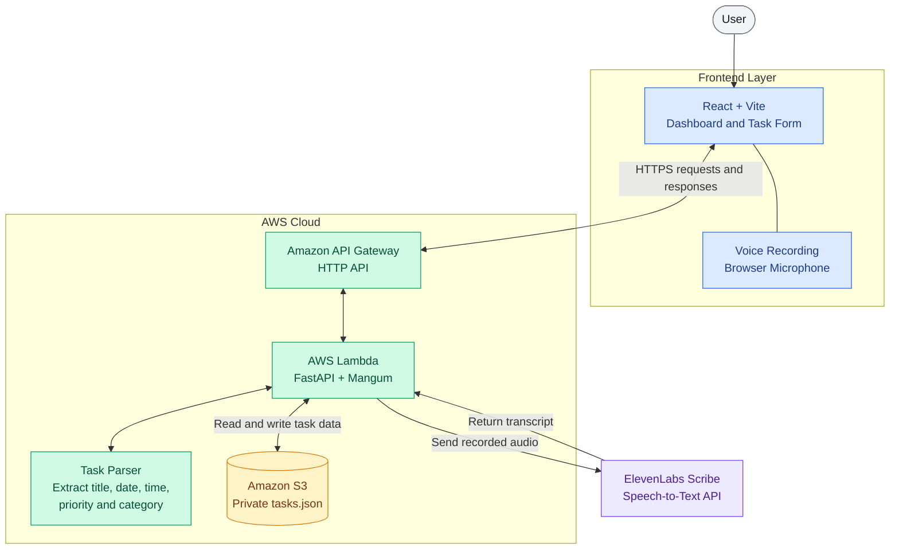

# VoiceTasks — Avanta Edition

**Speak naturally. Let AI organize your tasks.**

VoiceTasks is an AI-powered task management application that allows users to create and manage tasks using voice commands or a manual form. Users can speak naturally in supported languages, and the system transcribes their speech and extracts useful task details such as the task title, date, time, priority, and category.

This project combines a React frontend, a Python FastAPI backend, AWS cloud services, and ElevenLabs speech recognition.

The goal is to make task management simple, accessible, and convenient.

---

## Table of Contents

1. [What Is VoiceTasks?](#1-what-is-voicetasks)
2. [Main Features](#2-main-features)
3. [How the Application Works](#3-how-the-application-works)
4. [System Architecture](#4-system-architecture)
5. [Technologies Used](#5-technologies-used)
6. [Project Folder Structure](#6-project-folder-structure)
7. [Requirements](#7-requirements)
8. [Run the Frontend Locally](#8-run-the-frontend-locally)
9. [Run the Backend Locally](#9-run-the-backend-locally)
10. [Configure Environment Variables](#10-configure-environment-variables)
11. [AWS Deployment Guide](#11-aws-deployment-guide)
12. [API Endpoints](#12-api-endpoints)
13. [Voice Command Processing](#13-voice-command-processing)
14. [Security and Privacy](#14-security-and-privacy)
15. [Common Problems and Solutions](#15-common-problems-and-solutions)
16. [Current Limitations](#16-current-limitations)
17. [Future Improvements](#17-future-improvements)
18. [Learning Resources](#18-learning-resources)

---

## 1. What Is VoiceTasks?

VoiceTasks is a voice-enabled task manager designed to reduce the effort required to create and organize everyday tasks.

Normally, users have to open a form and manually enter information such as a task title, due date, time, priority, and category.

VoiceTasks aims to simplify this process.

For example, a user can say:

> "Submit my DBMS assignment tomorrow at 6 PM with high priority."

The application records the user's voice, converts the speech into text, and processes the text to identify the task details.

The extracted information can then be used to create a structured task.

### Who can use it?

- Students managing assignments, examinations, and deadlines.
- Professionals organizing meetings and daily work.
- Individuals managing personal reminders and responsibilities.
- Anyone who prefers speaking instead of typing.

---

## 2. Main Features

### Task Management

- Create tasks manually.
- View and search tasks.
- Filter tasks using available dashboard options.
- Edit existing tasks.
- Mark tasks as completed.
- Delete tasks.
- Organize tasks by priority and category.

### Voice-Based Task Creation

- Record a voice command using the microphone.
- Send recorded audio to the backend.
- Convert speech into text using ElevenLabs Scribe.
- Extract task details using backend parsing rules.
- Prepare structured task information for the frontend.

### Task Information

Depending on the command and the backend parser, task information can include:

- **Title:** What needs to be done.
- **Date:** When the task is due.
- **Time:** The requested deadline.
- **Priority:** Low, Medium, or High.
- **Category:** For example, College or General.

The parser may use defaults or leave fields empty when information is missing.

### Cloud Integration

- AWS Lambda runs the backend.
- Amazon API Gateway exposes the backend API.
- Amazon S3 stores task data in JSON format.
- ElevenLabs provides speech-to-text processing.

---

## 3. How the Application Works

Imagine a student wants to create a DBMS assignment task.

The process is as follows:

1. The user opens VoiceTasks in a browser.
2. The user clicks the microphone and speaks a command.
3. The browser records the audio.
4. The frontend sends the audio to the backend through an API request.
5. The backend sends the audio to ElevenLabs Scribe for transcription.
6. ElevenLabs returns the recognized text.
7. The backend parser identifies relevant task details.
8. The structured task information is returned to the frontend.
9. The user can review the information and create or manage the task.
10. When the task is saved, the backend stores the task data in Amazon S3.

**Important:** Speech recognition and task extraction are two different operations. ElevenLabs transcribes the audio; the backend parser interprets the resulting text.

---

## 4. System Architecture

VoiceTasks uses a React frontend, a FastAPI backend running on AWS Lambda, Amazon API Gateway, Amazon S3 for task storage, and ElevenLabs for speech-to-text processing.

### 4.1 Architecture Diagram



### 4.2 How the Components Work Together

| Component | Responsibility |
|---|---|
| React | Displays the dashboard and handles user interactions. |
| Vite | Runs the frontend development server and builds production files. |
| Browser microphone | Records the user's voice command. |
| API Gateway | Receives HTTP requests and forwards them to the backend. |
| AWS Lambda | Runs the backend code when requests arrive. |
| FastAPI | Defines the API routes and handles task operations. |
| Mangum | Adapts FastAPI to the AWS Lambda execution environment. |
| Task parser | Extracts task details from recognized text using application rules. |
| ElevenLabs Scribe | Converts uploaded audio into text. |
| Amazon S3 | Stores task records in a JSON object. |

### 4.3 Voice Command Flow

When a user speaks a task, the application follows this process:

1. The browser records the audio.
2. The frontend uploads the audio to the voice-command API.
3. API Gateway forwards the request to Lambda.
4. FastAPI sends the audio to ElevenLabs for transcription.
5. ElevenLabs returns the recognized text.
6. The task parser identifies available task details.
7. The backend returns the parsed result to the frontend.
8. When the task is saved, the backend updates the JSON data stored in S3.

**Important:** Speech recognition and task parsing are separate operations. Transcribing speech does not guarantee that every task detail will be extracted correctly or that non-English text will be translated into English.

### 4.4 Task Storage

The current backend stores tasks in a JSON object in Amazon S3 rather than in a PostgreSQL database.

The task-data bucket should remain private. The Lambda execution role should have only the S3 permissions required to access the task object.

A single JSON object is suitable for a prototype, but concurrent updates can overwrite one another. A database may be a better choice if the application later needs multi-user access or more scalable storage.

### 4.5 Current Deployment Status

The backend API is deployed using AWS Lambda and Amazon API Gateway.

**API base URL:**

`https://r4t3lgjswi.execute-api.ap-south-1.amazonaws.com`

The frontend uses the `VITE_API_URL` environment variable to identify the backend API.

The frontend can run locally using Vite. Hosting the production frontend on S3 or another hosting service is a separate deployment step and should be documented as completed only after it has been configured and tested.

The architecture diagram represents the current backend setup. It does not assume that frontend hosting on S3 has already been completed.


## 5. Technologies Used

### Frontend

- React 18
- Vite 6
- JavaScript
- HTML and CSS
- Lucide React icons

### Backend

- Python
- FastAPI
- Pydantic
- Mangum
- Boto3
- Requests
- Python Multipart
- Python Dotenv

### Cloud and External Services

- AWS Lambda
- Amazon API Gateway HTTP API
- Amazon S3
- ElevenLabs Scribe speech-to-text API

### Development Tools

- Visual Studio Code
- Node.js and npm
- Python virtual environment
- Git and GitHub
- AWS Management Console

---

## 6. Project Folder Structure

The main project folders are organized as follows. Your actual project may contain additional deployment scripts, certificates, and configuration files.

```text
voicetasks-avanta/
│
├── frontend/
│   ├── src/
│   │   ├── main.jsx
│   │   └── styles.css
│   │
│   ├── public/
│   ├── dist/
│   ├── node_modules/
│   │
│   ├── index.html
│   ├── package.json
│   ├── package-lock.json
│   ├── vite.config.js
│   ├── .env.example
│   ├── .env.local
│   └── README.md
│
├── backend/
│   ├── app/
│   │   ├── __init__.py
│   │   ├── main.py
│   │   ├── config.py
│   │   ├── schemas.py
│   │   └── task_parser.py
│   │
│   ├── requirements.txt
│   ├── .env.example
│   └── .env
│
├── .gitignore
└── README.md
```

### What Do These Files Do?

| File or Folder | Explanation |
|---|---|
| `frontend/src/main.jsx` | Main React application and dashboard logic. |
| `frontend/src/styles.css` | Styling, colors, layout, and responsive design. |
| `frontend/index.html` | HTML page that loads the React application. |
| `frontend/package.json` | Frontend dependencies and npm commands. |
| `frontend/vite.config.js` | Vite development server and HTTPS configuration. |
| `frontend/.env.local` | Local frontend environment configuration. |
| `frontend/dist/` | Production-ready website files generated by Vite. |
| `backend/app/main.py` | FastAPI application, routes, task storage, and voice endpoint. |
| `backend/app/config.py` | Backend configuration and environment variables. |
| `backend/app/schemas.py` | Pydantic models used to validate task data. |
| `backend/app/task_parser.py` | Rules for extracting information from recognized speech. |
| `backend/requirements.txt` | Python package dependencies. |
| `.env` files | Local configuration; must not contain values committed to Git. |

`node_modules/` contains installed JavaScript packages. It can be recreated using `npm install`.

`dist/` contains generated build files. It can be recreated using `npm run build`.

These generated folders should not be manually edited.

---

## 7. Requirements

Before running the project locally, install the following:

1. **Node.js:** Use a supported Node.js LTS release.
2. **npm:** Installed with Node.js.
3. **Python:** Python 3.11 is recommended for compatibility with the selected Lambda runtime.
4. **Visual Studio Code:** Recommended for editing project files.
5. **AWS account:** Required for the deployed API and S3 storage.
6. **ElevenLabs API key:** Required for speech-to-text requests.

Check whether Node.js and npm are installed:

```powershell
node --version
npm --version
```

Check Python:

```powershell
py -3.11 --version
```

If these commands fail, install the corresponding software before continuing.

---

## 8. Run the Frontend Locally

This section explains how to start the website on your computer.

### Step 1: Open the frontend folder

In the VS Code terminal:

```powershell
cd frontend
```

Run this command from the project root. If the terminal is already inside `frontend`, do not run it again.

### Step 2: Install dependencies

```powershell
npm install
```

This reads `package.json` and installs the required JavaScript packages.

### Step 3: Configure the API URL

Your `frontend/.env.local` should contain:

```dotenv
VITE_API_URL=https://r4t3lgjswi.execute-api.ap-south-1.amazonaws.com
```

This points the frontend to your deployed AWS API.

For local backend development instead, the URL can be:

```dotenv
VITE_API_URL=http://127.0.0.1:8000
```

Use the appropriate URL for the backend you want to test.

### Step 4: Start the development server

```powershell
npm run dev
```

Vite will display the local website URL in the terminal.

Open the displayed URL in your browser.

Your Vite configuration uses HTTPS and local certificate files. If Vite reports a certificate error or cannot find the certificate, check that the expected certificate files exist in the frontend folder.

**Note:** `localhost` and `127.0.0.1` are not always interchangeable for browser microphone permissions or HTTPS certificate validation. Use the exact URL shown by Vite and make sure your certificate is trusted by the browser.

### Step 5: Stop the server

Press `Ctrl + C` in the terminal.

---

## 9. Run the Backend Locally

Running the backend locally is optional if you are using the deployed AWS API.

### Step 1: Open the backend folder

From the project root:

```powershell
cd backend
```

### Step 2: Create a virtual environment

```powershell
py -3.11 -m venv .venv
```

A virtual environment keeps the backend's Python dependencies separate from other Python projects.

### Step 3: Activate it

```powershell
.\.venv\Scripts\Activate.ps1
```

If PowerShell blocks script execution, follow your organization's security policy or use a permitted terminal instead of changing system security settings blindly.

### Step 4: Install dependencies

```powershell
python -m pip install --upgrade pip
pip install -r requirements.txt
```

### Step 5: Configure the backend

Create `backend/.env` using `backend/.env.example` as a reference.

Configure the required values:

```dotenv
AWS_REGION=ap-south-1
TASKS_BUCKET=your-private-data-bucket
ELEVENLABS_API_KEY=your-elevenlabs-api-key
```

Replace the example values with your own configuration. Never commit real credentials.

### Step 6: Configure AWS credentials

For local development, configure AWS credentials through an appropriate AWS authentication method, such as the AWS CLI profile.

If you use the AWS CLI, run:

```powershell
aws configure
```

Use credentials belonging to an appropriately restricted IAM identity. Do not use root account credentials in your application.

### Step 7: Start FastAPI

From inside `backend/`:

```powershell
uvicorn app.main:app --reload
```

The local API is available at:

`http://127.0.0.1:8000`

Interactive API documentation is available at:

`http://127.0.0.1:8000/docs`

To stop the server, press `Ctrl + C`.

### Step 8: Connect the frontend to the local backend

Set the frontend API URL to:

```dotenv
VITE_API_URL=http://127.0.0.1:8000
```

Restart Vite after changing the environment file.

If your frontend uses HTTPS but the local API uses HTTP, browser security rules may block some requests. Use an appropriate local development setup and matching CORS configuration.

---

## 10. Configure Environment Variables

Environment variables keep configuration separate from source code.

### Frontend configuration

File: `frontend/.env.local`

```dotenv
VITE_API_URL=https://r4t3lgjswi.execute-api.ap-south-1.amazonaws.com
```

The `VITE_` prefix allows Vite to expose the variable to frontend code. Therefore, never store API secrets in a `VITE_` variable.

### Backend configuration

File: `backend/.env`

```dotenv
AWS_REGION=ap-south-1
TASKS_BUCKET=your-private-data-bucket
ELEVENLABS_API_KEY=your-elevenlabs-api-key
```

Your backend configuration may also support `CORS_ORIGINS`.

Use `backend/.env.example` to document the variables needed by the project, without storing real secrets in the example file.

### Important Rules

- Never commit `.env`, `.env.local`, API keys, AWS secret keys, or private certificates.
- Keep `.env.example` files free of real secrets.
- Lambda environment variables must be configured in AWS separately from your local `.env` file.
- Do not configure reserved Lambda environment-variable names such as `AWS_REGION` manually in Lambda.
- After changing frontend environment variables, restart Vite or rebuild the frontend as appropriate.

---

## 11. AWS Deployment Guide

This section explains the cloud deployment process. Some steps depend on resources already created in your AWS account.

### 11.1 Create the private S3 data bucket

Create an S3 bucket dedicated to task storage.

Requirements:

- Use a globally unique bucket name.
- Keep Block Public Access enabled.
- Do not enable public website hosting on this bucket.
- Grant access only to authorized identities and services.

The backend stores task information in a JSON object, configured by the application.

### 11.2 Create the frontend hosting bucket

Create a second S3 bucket for the website.

This bucket is separate from the private task-data bucket.

If you use S3 static website hosting, understand that ordinary S3 website endpoints do not provide HTTPS directly. For an HTTPS production website, use an appropriate hosting architecture, such as CloudFront with an S3 origin and suitable access controls.

Do not make the task-data bucket public to make the website work.

### 11.3 Build the frontend

From `frontend/`:

```powershell
npm install
npm run build
```

Vite generates the production files in:

```text
frontend/dist/
```

Upload the contents of `dist/` to the configured frontend hosting destination.

The frontend build must use the correct deployed API URL.

### 11.4 Prepare the backend for Lambda

AWS Lambda requires a compatible deployment package.

The backend depends on Python packages listed in `backend/requirements.txt`. Build the deployment package for the Lambda Python runtime and Linux environment.

When developing on Windows, use an appropriate Linux build environment, such as AWS CloudShell, or a compatible build process. A normal Windows virtual environment should not simply be copied into Lambda.

Include the backend application package and its dependencies in the deployment artifact.

### 11.5 Configure the Lambda function

Create or update a Python Lambda function.

For this project, the handler is:

```text
app.main.handler
```

The `handler` object is provided by Mangum, which adapts the FastAPI application for Lambda.

Configure the required environment variables in Lambda. The backend needs the task bucket name and ElevenLabs API key, along with any other application-specific settings.

Do not manually define Lambda's reserved `AWS_REGION` environment variable.

### 11.6 Configure IAM permissions

Give the Lambda execution role only the permissions required by the application.

For task storage, the role may need:

- `s3:GetObject` for the task JSON object.
- `s3:PutObject` for updating the task JSON object.
- `s3:ListBucket` only if the application actually lists bucket contents.

Scope object permissions to the relevant bucket and key wherever possible. Lambda logging permissions should also be configured.

### 11.7 Configure API Gateway

Create an API Gateway HTTP API with a Lambda integration.

Configure routes so that the API requests reach the FastAPI application. Confirm that the routes used by the frontend are supported by the integration.

Enable CORS for the actual frontend origin. Configure the necessary methods and headers.

For example, local development and production hosting may use different origins. Do not assume that allowing `localhost` automatically allows the deployed website.

### 11.8 Test the health endpoint

Open:

```text
https://r4t3lgjswi.execute-api.ap-south-1.amazonaws.com/api/health
```

A successful response should indicate that the health route is working.

If it fails, inspect the Lambda logs, API Gateway integration, deployment status, and configured routes.

### 11.9 Test task storage

After confirming the health endpoint:

1. Open the frontend.
2. Check that the task list loads.
3. Create a test task.
4. Verify that the task is saved.
5. Refresh the page and check whether the task remains.
6. Test editing, completion, and deletion.
7. Test voice transcription separately.

A successful health response alone does not prove that S3 storage or speech recognition is working.

---

## 12. API Endpoints

The backend exposes the following endpoints.

| Method | Endpoint | Purpose |
|---|---|---|
| GET | `/api/health` | Check API health. |
| GET | `/api/tasks` | Retrieve stored tasks. |
| POST | `/api/tasks` | Create a task. |
| PATCH | `/api/tasks/{task_id}` | Update an existing task. |
| DELETE | `/api/tasks/{task_id}` | Delete a task. |
| POST | `/api/voice-command` | Transcribe a voice command and parse task details. |

### Example: Health Check

Request:

```http
GET /api/health
```

### Example: Create a Task

Request:

```http
POST /api/tasks
Content-Type: application/json
```

Example body:

```json
{
  "title": "Submit DBMS assignment",
  "date": "2026-10-14",
  "time": "18:00",
  "priority": "High",
  "category": "College",
  "completed": false
}
```

This is an example request body. The actual date must be adjusted to the intended deadline.

### Example: Voice Command

The voice endpoint accepts a multipart form upload using the field name:

```text
audio
```

The request must contain an audio file in a format supported by the transcription service.

### Testing the API

You can inspect and test FastAPI endpoints through `/docs` when running the backend locally. For the deployed API, use an appropriate HTTP client or the frontend.

---

## 13. Voice Command Processing

Voice command processing has three main stages.

### Stage 1: Audio Recording

The browser requests microphone access and records audio using the browser's recording functionality.

The recorded audio is uploaded to the backend using a multipart HTTP request.

### Stage 2: Speech-to-Text

The backend sends the audio to the ElevenLabs Scribe speech-to-text API.

The transcription service returns recognized text. Automatic language detection depends on the transcription service's supported behavior and configuration.

The user should not need to select a language manually when the configured transcription flow detects it automatically.

### Stage 3: Task Parsing

The backend parser processes the recognized text using application rules.

For example:

**Recognized speech:**

```text
Submit my DBMS assignment tomorrow at 6 PM with high priority.
```

**Possible parsed task:**

```json
{
  "title": "Submit DBMS assignment",
  "date": "2026-10-14",
  "time": "18:00",
  "priority": "High",
  "category": "College"
}
```

This is an illustrative result, not a guarantee that every sentence will be parsed perfectly.

The date shown assumes the command is spoken on October 13, 2026. Actual results depend on the current date, parser rules, and the information recognized from speech.

**Important:** Speech-to-text does not automatically guarantee translation into English. If a user speaks Punjabi or Hindi and the resulting transcript remains in that language, the current task parser may not always produce a natural English task title. Reliable translation is a separate capability that can be added and tested.

---

## 14. Security and Privacy

VoiceTasks uses cloud services and may process personal task information and recorded audio.

Follow these security practices:

- Keep the task-data S3 bucket private.
- Never place AWS secret keys or the ElevenLabs API key in frontend code.
- Store backend credentials in secure configuration.
- Restrict IAM permissions to the minimum required.
- Configure CORS for trusted website origins.
- Use HTTPS for deployed applications.
- Avoid logging API keys, sensitive task information, or raw audio unnecessarily.
- Review the retention and privacy policies of external speech services.
- Do not upload private certificates or private keys to a public repository.
- Use authentication and authorization before exposing personal task data to multiple users.

CORS is a browser access policy, not a substitute for authentication.

---

## 15. Common Problems and Solutions

### Problem 1: The frontend cannot connect to the API

Check:

- `VITE_API_URL` is correct.
- The API Gateway deployment is active.
- The requested route exists.
- CORS permits the frontend's exact origin.
- The browser console shows no mixed-content or certificate errors.

Restart Vite after changing environment variables.

### Problem 2: Lambda returns an internal server error

Check the Lambda logs in Amazon CloudWatch.

Common causes include:

- Missing Python dependencies.
- An incorrect Lambda handler.
- Incorrect deployment-package structure.
- Missing environment variables.
- Insufficient S3 permissions.
- Errors in the FastAPI application.

### Problem 3: Tasks do not persist

Check:

- The configured task bucket exists.
- The Lambda execution role has the necessary S3 permissions.
- The task object's key matches the backend configuration.
- The Lambda logs show no S3 access errors.

### Problem 4: The microphone does not work

Check:

- Microphone permission is granted in the browser.
- The page is served in a secure context.
- The correct microphone is selected by the operating system.
- The browser supports the recording API.
- The audio is uploaded using the expected multipart field name, `audio`.

### Problem 5: Voice transcription fails

Check:

- The ElevenLabs API key is valid.
- The backend can reach the transcription service.
- The audio format is supported.
- The API quota and billing settings permit the request.
- The Lambda timeout and request-size limits are suitable.

### Problem 6: The task title or date is incorrect

Speech recognition can make mistakes, and rule-based parsing has limitations.

Review the transcript and extracted fields. Improve the parser or add a translation stage when necessary.

### Problem 7: Vite cannot find the certificate files

The current Vite configuration expects the configured certificate and private key files in the frontend directory.

Check the filenames and paths. Never share the private key publicly.

---

## 16. Current Limitations

VoiceTasks is a prototype and has important limitations.

- Task data is stored in a single JSON object in S3.
- Concurrent updates may overwrite each other.
- There is no guarantee of correct interpretation for every voice command.
- Speech recognition accuracy depends on audio quality and service support.
- Translation of non-English task titles is not guaranteed by transcription alone.
- Authentication and multi-user access must be implemented before a public multi-user deployment.
- Production hosting, monitoring, rate limiting, and recovery procedures require further hardening.

A single JSON object is useful for a simple demonstration, but it is not an ideal storage architecture for a high-traffic application.

---

## 17. Future Improvements

Possible future improvements include:

- Hindi and Punjabi task-title translation into English.
- More accurate natural-language date and time extraction.
- Task reminders and notifications.
- User accounts and authentication.
- A database for scalable task storage.
- Better validation before saving voice-created tasks.
- Improved accessibility and mobile responsiveness.
- Automated backend and frontend tests.
- Deployment automation and monitoring.

These are potential improvements, not claims that every feature is already implemented.

---

## 18. Learning Resources

Use the official documentation to understand the technologies used in this project.

- React: https://react.dev/
- Vite: https://vite.dev/guide/
- FastAPI: https://fastapi.tiangolo.com/
- Pydantic: https://docs.pydantic.dev/
- Mangum: https://mangum.fastapiexpert.com/
- AWS Lambda: https://docs.aws.amazon.com/lambda/
- Amazon API Gateway: https://docs.aws.amazon.com/apigateway/
- Amazon S3: https://docs.aws.amazon.com/s3/
- ElevenLabs Speech-to-Text: https://elevenlabs.io/docs

---

## Project Summary

VoiceTasks demonstrates how a web application can combine a modern frontend, a Python API, cloud storage, serverless computing, and speech recognition.

The browser provides the interface, FastAPI processes requests, Lambda runs the backend, S3 stores task data, and ElevenLabs converts recorded speech into text.

Understanding the role of each component makes the project easier to maintain, debug, extend, and deploy.

**VoiceTasks — Make task management as simple as speaking.**